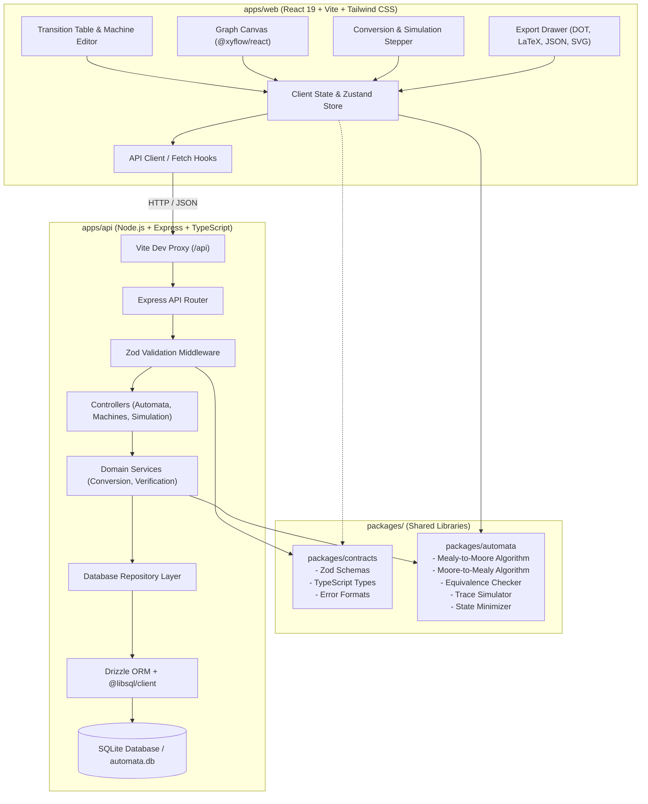

# AutomataLab — System Architecture

This document outlines the high-level architecture, module decomposition, data flows, and design principles of **AutomataLab**.

---

## 1. System Overview Flowchart



---

## 2. Monorepo Package Topology

AutomataLab is organized as an **npm workspaces** monorepo with clear separation between user interface, server orchestration, algorithmic processing, and domain contracts.

```
AutomataLab/
├── apps/
│   ├── web/                     # React application
│   │   ├── src/
│   │   │   ├── components/      # UI components (Canvas, Table, Toolbar, Trace)
│   │   │   ├── hooks/           # Custom React hooks
│   │   │   ├── stores/          # State management (active machine, conversion)
│   │   │   ├── lib/             # Graph layout helpers, export formatters
│   │   │   └── App.tsx
│   │   ├── vite.config.ts       # Vite configuration with /api proxy
│   │   ├── tailwind.config.js   # Developer-tool theme tokens
│   │   └── package.json
│   │
│   └── api/                     # Express REST backend
│       ├── src/
│       │   ├── controllers/     # HTTP endpoint handlers
│       │   ├── services/        # Orchestration & conversion execution
│       │   ├── routes/          # Express route declarations
│       │   ├── db/              # Drizzle schema, connection, migrations
│       │   │   ├── schema.ts    # Machines & Preset table definitions
│       │   │   └── index.ts     # LibSQL client & Drizzle db instance
│       │   ├── middleware/      # Error handler, Zod request validator
│       │   └── index.ts         # Server entry point
│       ├── drizzle.config.ts    # Drizzle ORM migration configuration
│       └── package.json
│
├── packages/
│   ├── automata/                # Pure mathematical engine
│   │   ├── src/
│   │   │   ├── mealy-to-moore.ts # Mealy-to-Moore conversion with step trace
│   │   │   ├── moore-to-mealy.ts # Moore-to-Mealy conversion with step trace
│   │   │   ├── equivalence.ts    # FSM equivalence verification & counterexamples
│   │   │   ├── simulator.ts      # String tape simulation engine
│   │   │   ├── minimizer.ts      # Transducer state minimization
│   │   │   ├── presets.ts        # Built-in reference machines
│   │   │   └── index.ts
│   │   └── package.json
│   │
│   └── contracts/               # Shared domain contracts & validation
│       ├── src/
│       │   ├── machine.ts       # MealyMachine & MooreMachine schemas and types
│       │   ├── conversion.ts    # Conversion request, response & step schemas
│       │   ├── simulation.ts    # Simulation trace schemas
│       │   ├── api.ts           # Standard API response wrappers
│       │   └── index.ts
│       └── package.json
│
├── docs/                        # Architecture, specs, and design guidelines
├── AGENTS.md                    # Permanent engineering guardrails
├── .gitignore
├── .env.example
├── package.json                 # Monorepo root scripts & workspaces definition
└── README.md
```

---

## 3. Package Responsibilities & Boundaries

### 3.1 `packages/contracts`
- **Zero dependencies** except `zod`.
- Defines canonical TypeScript types inferred directly from Zod schemas:
  - `MealyMachine`, `MooreMachine`
  - `State`, `Transition`, `Output`
  - `ConversionStep`, `ConversionResult`
  - `SimulationStep`, `SimulationResult`
- Guarantees 100% type parity between frontend client and backend API.

### 3.2 `packages/automata`
- **Zero external dependencies** (relies solely on `packages/contracts` for data structures).
- Pure functions only: no DOM, no file I/O, no network calls.
- Every conversion returns both the destination machine and an explanatory step trace:
  $$\text{convertMealyToMoore}(M) \to \{ \text{mooreMachine}, \text{steps}, \text{metrics} \}$$
  $$\text{convertMooreToMealy}(M) \to \{ \text{mealyMachine}, \text{steps}, \text{metrics} \}$$
- Can be executed client-side in React for offline-capable immediate updates or server-side via Express endpoints.

### 3.3 `apps/api`
- Express 4/5 REST API with strict Zod validation middleware.
- **Drizzle ORM** with `@libsql/client` (SQLite):
  - Stores user saved machines, custom presets, and conversion histories.
  - Zero-configuration local file SQLite database (`automata.db`).
- Layered separation:
  - `Router` $\to$ `Validator` $\to$ `Controller` $\to$ `Service` $\to$ `Repository` $\to$ `Database`.

### 3.4 `apps/web`
- React 19 + Vite + Tailwind CSS.
- Fast developer-tool interface:
  - State machine visualization with `@xyflow/react`.
  - Matrix table transition editor.
  - Interactive tape stepper with playback controls.
  - Split-view comparison mode.
- Development proxy configured in `vite.config.ts` forward-routing `/api/*` to `http://localhost:3001`.

---

## 4. API Endpoints Contract

| Method | Route | Description |
|---|---|---|
| `GET` | `/api/health` | Health check endpoint returning status and uptime |
| `POST` | `/api/convert/mealy-to-moore` | Validates Mealy machine, computes Moore machine and trace |
| `POST` | `/api/convert/moore-to-mealy` | Validates Moore machine, computes Mealy machine and trace |
| `POST` | `/api/verify-equivalence` | Evaluates functional equivalence of two machines |
| `POST` | `/api/simulate` | Simulates an input string across one or two machines |
| `GET` | `/api/presets` | Retrieves catalog of standard reference machines |
| `GET` | `/api/presets/:id` | Retrieves a specific preset machine |
| `GET` | `/api/machines` | Lists saved machines from SQLite database |
| `POST` | `/api/machines` | Saves a new machine configuration |
| `GET` | `/api/machines/:id` | Retrieves a saved machine |
| `DELETE` | `/api/machines/:id` | Deletes a saved machine |

---

## 5. Database Schema (Drizzle ORM + SQLite)

```typescript
// apps/api/src/db/schema.ts
import { sqliteTable, text, integer } from 'drizzle-orm/sqlite-core';

export const machines = sqliteTable('machines', {
  id: text('id').primaryKey(),
  name: text('name').notNull(),
  description: text('description'),
  type: text('type').notNull(), // 'mealy' | 'moore'
  machineData: text('machine_data', { mode: 'json' }).notNull(),
  createdAt: integer('created_at', { mode: 'timestamp' }).notNull(),
  updatedAt: integer('updated_at', { mode: 'timestamp' }).notNull(),
});

export const conversionHistory = sqliteTable('conversion_history', {
  id: text('id').primaryKey(),
  sourceType: text('source_type').notNull(),
  targetType: text('target_type').notNull(),
  sourceMachineData: text('source_machine_data', { mode: 'json' }).notNull(),
  resultMachineData: text('result_machine_data', { mode: 'json' }).notNull(),
  stepsData: text('steps_data', { mode: 'json' }).notNull(),
  createdAt: integer('created_at', { mode: 'timestamp' }).notNull(),
});
```

---

## 6. Testing Strategy

1. **Algorithmic Correctness (`packages/automata`)**:
   - Tested using **Vitest**.
   - Tests verify state transitions, state splitting, output preservation, and edge cases (unreachable states, cyclical state graphs, disconnected nodes).
2. **Contract Validation (`packages/contracts`)**:
   - Tests verify schema parsing, invalid state transition rejection, and empty alphabet handling.
3. **API Integration (`apps/api`)**:
   - Tested using **Vitest** + **Supertest**.
   - Validates HTTP response codes, error serialization, and database persistence.
4. **End-to-End Simulation**:
   - Bidirectional identity tests: $\text{Moore} \to \text{Mealy} \to \text{Moore}$ with minimization verifying equivalent input-output behavior.
