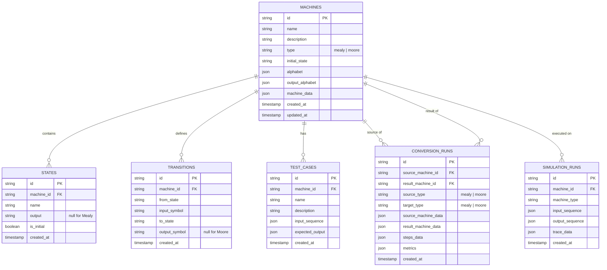

# AutomataLab — Database Schema & Persistence Guide

This document describes the relational database schema, ORM configurations, transactional integrity, repositories, migrations, and seeding implemented for **AutomataLab**.

---

## 1. Overview & Technology Stack

- **RDBMS**: SQLite (file-based or in-memory)
- **Database Driver**: `@libsql/client` (LibSQL / SQLite native client)
- **ORM**: Drizzle ORM
- **Migration Tool**: Drizzle Kit
- **Isolation Principle**: Pure automata transformation algorithms remain 100% side-effect-free in `packages/automata`. All persistence concerns are strictly isolated in `apps/api/src/db` and `apps/api/src/repositories`.

---

## 2. Entity-Relationship Model

---

## 3. Database Schema Definitions (`apps/api/src/db/schema.ts`)

### 3.1 `machines`
Stores root finite state machine metadata and serialized representations.
- `id` (`TEXT PRIMARY KEY`): Unique UUID.
- `name` (`TEXT NOT NULL`): Human-readable name.
- `description` (`TEXT`): Optional description.
- `type` (`TEXT NOT NULL`): `'mealy'` or `'moore'`.
- `initial_state` (`TEXT NOT NULL`): Starting state name.
- `alphabet` (`TEXT NOT NULL JSON`): Array of input symbols (e.g. `["0", "1"]`).
- `output_alphabet` (`TEXT NOT NULL JSON`): Array of output symbols (e.g. `["x", "y"]`).
- `machine_data` (`TEXT NOT NULL JSON`): Full domain object matching `AnyMachine`.
- `created_at` (`INTEGER NOT NULL`): Millisecond UNIX timestamp.
- `updated_at` (`INTEGER NOT NULL`): Millisecond UNIX timestamp.

### 3.2 `states`
Relational representation of states associated with a machine.
- `id` (`TEXT PRIMARY KEY`): Unique UUID.
- `machine_id` (`TEXT NOT NULL REFERENCES machines(id) ON DELETE CASCADE`): Parent machine.
- `name` (`TEXT NOT NULL`): State identifier (e.g. `A`, `q0`, `S`, `A_x`).
- `output` (`TEXT`): Associated Moore state output symbol; `null` for Mealy states.
- `is_initial` (`INTEGER NOT NULL DEFAULT 0`): Boolean flag indicating if this is the start state.
- `created_at` (`INTEGER NOT NULL`): Timestamp.
- **Unique Index**: `(machine_id, name)` guarantees no duplicate state names per machine.

### 3.3 `transitions`
Relational representation of deterministic state transitions.
- `id` (`TEXT PRIMARY KEY`): Unique UUID.
- `machine_id` (`TEXT NOT NULL REFERENCES machines(id) ON DELETE CASCADE`): Parent machine.
- `from_state` (`TEXT NOT NULL`): Source state identifier.
- `input_symbol` (`TEXT NOT NULL`): Input character or multi-character symbol.
- `to_state` (`TEXT NOT NULL`): Destination state identifier.
- `output_symbol` (`TEXT`): Output emitted during transition (Mealy); `null` for Moore.
- `created_at` (`INTEGER NOT NULL`): Timestamp.
- **Unique Index**: `(machine_id, from_state, input_symbol)` enforces mathematical determinism at the database layer.

### 3.4 `conversion_runs`
Audit and history log of algorithmic transformations.
- `id` (`TEXT PRIMARY KEY`): Unique UUID.
- `source_machine_id` (`TEXT REFERENCES machines(id) ON DELETE SET NULL`): Optional foreign key to persisted source machine.
- `result_machine_id` (`TEXT REFERENCES machines(id) ON DELETE SET NULL`): Optional foreign key to persisted resulting machine.
- `source_type` (`TEXT NOT NULL`): `'mealy'` or `'moore'`.
- `target_type` (`TEXT NOT NULL`): `'mealy'` or `'moore'`.
- `source_machine_data` (`TEXT NOT NULL JSON`): Source machine definition.
- `result_machine_data` (`TEXT NOT NULL JSON`): Resulting converted machine definition.
- `steps_data` (`TEXT NOT NULL JSON`): Array of discrete mathematical conversion step traces.
- `metrics` (`TEXT JSON`): Execution time (ms), state counts, and transition counts.
- `created_at` (`INTEGER NOT NULL`): Timestamp.

### 3.5 `simulation_runs`
Logs of execution simulations over string input tapes.
- `id` (`TEXT PRIMARY KEY`): Unique UUID.
- `machine_id` (`TEXT REFERENCES machines(id) ON DELETE SET NULL`): Machine simulated.
- `machine_type` (`TEXT NOT NULL`): `'mealy'` or `'moore'`.
- `input_sequence` (`TEXT NOT NULL JSON`): Array of input symbols consumed.
- `output_sequence` (`TEXT NOT NULL JSON`): Array of output symbols emitted.
- `trace_data` (`TEXT NOT NULL JSON`): Complete simulation step records.
- `created_at` (`INTEGER NOT NULL`): Timestamp.

### 3.6 `test_cases`
Reusable acceptance test cases attached to machines.
- `id` (`TEXT PRIMARY KEY`): Unique UUID.
- `machine_id` (`TEXT NOT NULL REFERENCES machines(id) ON DELETE CASCADE`): Associated machine.
- `name` (`TEXT NOT NULL`): Test case title.
- `description` (`TEXT`): Optional notes.
- `input_sequence` (`TEXT NOT NULL JSON`): Input tape symbols.
- `expected_output` (`TEXT NOT NULL JSON`): Expected output tape symbols.
- `created_at` (`INTEGER NOT NULL`): Timestamp.

---

## 4. Transactional Integrity & Repository Layer

All repository implementations are in `apps/api/src/repositories/`:
- **`MachineRepository.createWithRelations`**: Wraps the insertion of the root `machines` record and all associated `states` and `transitions` in an atomic database transaction (`tx`). If an invalid transition or duplicate state violates constraints, the entire transaction rolls back.
- **`MachineRepository.updateWithRelations`**: Transactionally updates root attributes and atomically refreshes all child states and transitions.
- **Foreign Keys**: `PRAGMA foreign_keys = ON;` is enforced on every connection. Cascading deletions (`ON DELETE CASCADE`) guarantee zero orphaned states or transitions.
- **Ad-Hoc Conversion Support**: Conversions and simulations accept unsaved machine objects; repository foreign keys to `machines` are nullable (`ON DELETE SET NULL`) and only bound if the entity exists in SQLite.

---

## 5. Migrations & Seeding Commands

| Command | Action |
|---|---|
| `npm run db:generate` | Inspects `schema.ts` and creates Drizzle SQL migration files in `apps/api/drizzle/` |
| `npm run db:seed` | Populates database with standard reference presets (`MANDATORY_TASK_6_MEALY`, `EVEN_PARITY_MEALY`, `EVEN_PARITY_MOORE`, `SEQUENCE_101_MEALY`) |
| `npm run db:studio` | Opens local Drizzle Studio browser interface for visual inspection |
